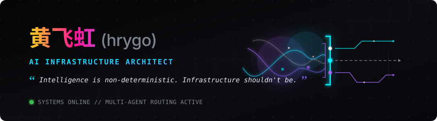

<div align="center">
  <picture>
    <source media="(prefers-color-scheme: dark)" srcset="https://raw.githubusercontent.com/hrygo/hrygo/main/header.svg">
    <source media="(prefers-color-scheme: light)" srcset="https://raw.githubusercontent.com/hrygo/hrygo/main/header.svg">
    
  </picture>
</div>

<br/>

<p align="center">
  
  
</p>

<br/>

### `[ FLAGSHIP ] // 核心旗舰`

**[HotPlex](https://github.com/hrygo/hotplex)** `Go` `Apache-2.0`
> **Unified Access Layer for AI Coding Agents**
>
> 高并发 WebSocket 架构，打通本地自主 Worker（Claude Code、OpenCode）与企业 IM（Slack、飞书）。内置多模型动态路由、自愈重试与零停机编排。

<br/>

### `[ ACTIVE PROJECTS ] // 重点方向与代表作`

**[Delegra](https://github.com/hrygo/Delegra)** `TypeScript`
> **Agent Management & Collaboration Workspace**
>
> 面向真实工作场景的开源多 Agent 管理与协同工作台：组织、调度并委派 AI Agent 执行团队级实际工作任务。

**[SpeechNexus](https://github.com/hrygo/SpeechNexus)** `Python` · `vLLM`
> **Enterprise Distributed Speech Platform**
>
> 基于 vLLM 与 vLLM-Omni 构建的企业级全双工实时/离线语音底座。支持生产级吞吐调度、低延迟推理与一体化管理控制面。

**[SpeechRail](https://github.com/hrygo/SpeechRail)** `Swift` · `Python` · `Apple Silicon`
> **Local-First ASR/TTS Speech Service**
>
> 专为 Apple Silicon (MLX) 深度优化的单机高可用语音服务。完整 OpenAI 兼容 REST / Realtime WebSocket 协议，单机微秒级治理与零外网依赖。

**[heluo-forge](https://github.com/hrygo/heluo-forge)** `Platform`
> **Enterprise Agentic Engineering Platform**
>
> 河洛企业级智能研发平台方案与 Agentic Workflows 落地扩展工程。

**[WorldofMysteries](https://github.com/hrygo/WorldofMysteries)** `SwiftUI` · `Python`
> **《诡秘世界》AI 互动叙事游戏**
>
> “世界不会重置，角色不会失忆”。维多利亚蒸汽朋克 × 克苏鲁神秘学，宇宙按回合持续演化。SwiftUI macOS 原生客户端 + 本地 LLM 引擎。

**[ClawReel](https://github.com/hrygo/clawreel)** `Python`
> **Autonomous Pipeline with HITL Governance**
>
> Agent 驱动的全流程自动化流水线，集成 Human-in-the-Loop (HITL) 决策检查点与算力成本治理。

<br/>

### `[ STACK ] // Technical Arsenal`

<div align="center">
  
</div>

<details>
<summary><b>技术栈详情</b></summary>

```text
LANGUAGES       Go · Python · Swift · C · TypeScript · Shell
DOMAINS         AI Agent Infra · LLM Gateways · Multimodal Systems · Real-time Speech
PROTOCOLS       MCP · Agent Exchange Protocol (AEP) · WebSocket · MRCP · OpenAI API
INFRASTRUCTURE  Docker · Traefik · Apple Silicon (MLX) · vLLM · Redis · Systemd
CORE FOCUS      Fault Tolerance · Backpressure Management · Finite State Machines · Zero-Downtime
```

</details>

<br/>

### `[ ARCHIVE ] // 更多工程沉淀`

<details>
<summary><b>展开查看更多项目 (10+)</b></summary>

[gosms](https://github.com/hrygo/gosms) (51★) · [Hikmah](https://github.com/hrygo/hikmah) · [ImageHive](https://github.com/hrygo/ImageHive) · [lotm-card-art](https://github.com/hrygo/lotm-card-art) · [dsh-speechrail-bundle](https://github.com/hrygo/dsh-speechrail-bundle) · [SparkForge](https://github.com/hrygo/SparkForge) · [The Council](https://github.com/hrygo/council) · [openclaw-watchdog](https://github.com/hrygo/openclaw-watchdog) · [security-shield](https://github.com/hrygo/security-shield) · [SpecBuilder](https://github.com/hrygo/SpecBuilder) · [Sona](https://github.com/hrygo/sona) · [echomind](https://github.com/hrygo/echomind) · [phantom-stream](https://github.com/hrygo/phantom-stream) · [obsidian-skills](https://github.com/hrygo/obsidian-skills)

</details>

<br/>

### `[ TELEMETRY ] // System Metrics`

<div align="center">
  <picture>
    <source media="(prefers-color-scheme: dark)" srcset="https://github-readme-stats-anuraghazra1.vercel.app/api?username=hrygo&show_icons=true&hide_border=true&bg_color=0d1117&title_color=b066fe&icon_color=00f2fe&text_color=8b949e&text_bold=false">
    <source media="(prefers-color-scheme: light)" srcset="https://github-readme-stats-anuraghazra1.vercel.app/api?username=hrygo&show_icons=true&hide_border=true&bg_color=ffffff&title_color=4f46e5&icon_color=0969da&text_color=57606a&text_bold=false">
    
  </picture>
  <picture>
    <source media="(prefers-color-scheme: dark)" srcset="https://github-readme-stats-anuraghazra1.vercel.app/api/top-langs/?username=hrygo&layout=compact&hide_border=true&bg_color=0d1117&title_color=b066fe&text_color=8b949e&langs_count=8">
    <source media="(prefers-color-scheme: light)" srcset="https://github-readme-stats-anuraghazra1.vercel.app/api/top-langs/?username=hrygo&layout=compact&hide_border=true&bg_color=ffffff&title_color=4f46e5&text_color=57606a&langs_count=8">
    
  </picture>
</div>

<div align="center">
  <picture>
    <source media="(prefers-color-scheme: dark)" srcset="https://streak-stats.demolab.com?user=hrygo&background=00000000&border=00000000&ring=b066fe&fire=00f2fe&currStreakLabel=8b949e&sideLabels=8b949e&dates=8b949e&currStreakNum=ffffff&sideNums=ffffff">
    <source media="(prefers-color-scheme: light)" srcset="https://streak-stats.demolab.com?user=hrygo&background=00000000&border=00000000&ring=6366f1&fire=0969da&currStreakLabel=57606a&sideLabels=57606a&dates=57606a&currStreakNum=24292f&sideNums=24292f">
    
  </picture>
</div>

<br/>

### `[ HANDSHAKE ] // Establish Connection`

<div align="center">

[](https://github.com/hrygo)
[](mailto:aaronwong1989@gmail.com)

<br/>

<sub><i>Reliability is the absence of surprise.</i></sub>

</div>

<br/>

<div align="right">
  <sub>
    
  </sub>
</div>
